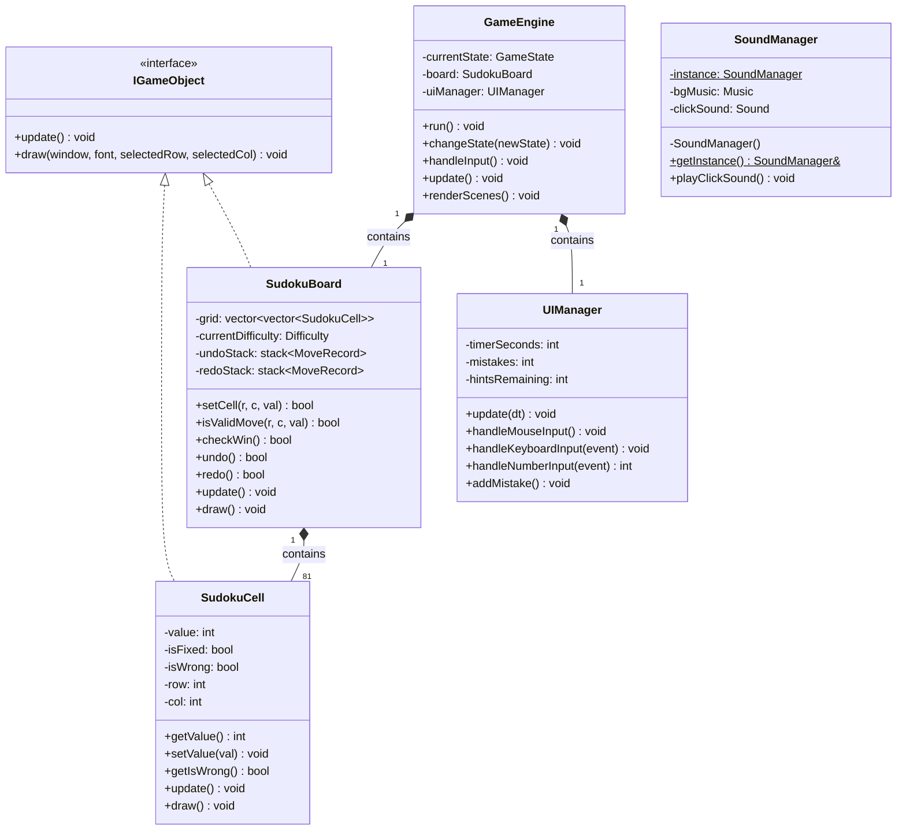
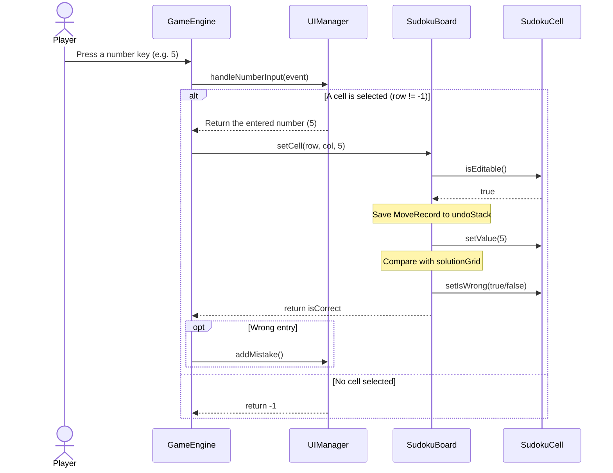

# 🎮 Sudoku-Project

A Sudoku game written in **C++**, using the **SFML** library for graphics and audio. It applies **Object-Oriented Programming (OOP)** principles and a **Backtracking** algorithm to generate and solve puzzles.

> Object-Oriented Programming course project – Class 25C08 – University of Science, VNU-HCM

---

## 🛠 Tech Stack

| Component | Details |
|---|---|
| Language | C++17 |
| Library | [SFML](https://www.sfml-dev.org/) – Graphics, Window, Audio, System modules |
| Data structures | `std::vector`, `std::stack` |
| Design patterns | Singleton (`SoundManager`), State (`GameState`) |
| Storage | `sudoku_save.json` (saved game), `records.txt` (best times) |

---

## 📂 Project Structure

```
Sudoku-Project/
├── assets/        # Resources: images, fonts, sounds
├── include/       # Header files (.h)
├── source/        # Source files (.cpp)
├── records.txt    # Best completion times per difficulty
├── .gitignore
├── LICENSE
└── README.md
```

| Module | Responsibility |
|---|---|
| `GameEngine` | Runs the game loop (Input → Update → Render), manages `GameState`, saves/loads games |
| `SudokuLogic` | `IGameObject`, `SudokuCell`, `SudokuBoard`: game rules, Backtracking generation/solving, Undo/Redo |
| `UIManager` | Draws the SFML interface, buttons, timer, mistakes, hints, and the leaderboard |
| `SoundManager` | Singleton that manages background music and sound effects |

---

## 🧱 Class Diagram (UML)



---

## 🔄 Workflow: Entering a Number



---

## ▶️ Run the Game

**1. Clone the repository**

```bash
git clone https://github.com/phutrong666777-oss/Sudoku-Project.git
cd Sudoku-Project
```

**2. Install SFML**

```bash
# Ubuntu / Debian
sudo apt install libsfml-dev g++

# macOS
brew install sfml
```

On Windows: download SFML from [sfml-dev.org](https://www.sfml-dev.org/download.php), configure the `include`/`lib` paths, and copy the SFML `.dll` files next to the `.exe`.

**3. Build**

```bash
g++ -std=c++17 -I include source/*.cpp -o Sudoku \
    -lsfml-graphics -lsfml-window -lsfml-audio -lsfml-system
```

**4. Run**

```bash
./Sudoku        # Linux / macOS
Sudoku.exe      # Windows
```

> ⚠️ Run the game **from the project root directory** so the program can find the `assets/` folder and the `records.txt` and `sudoku_save.json` files.
